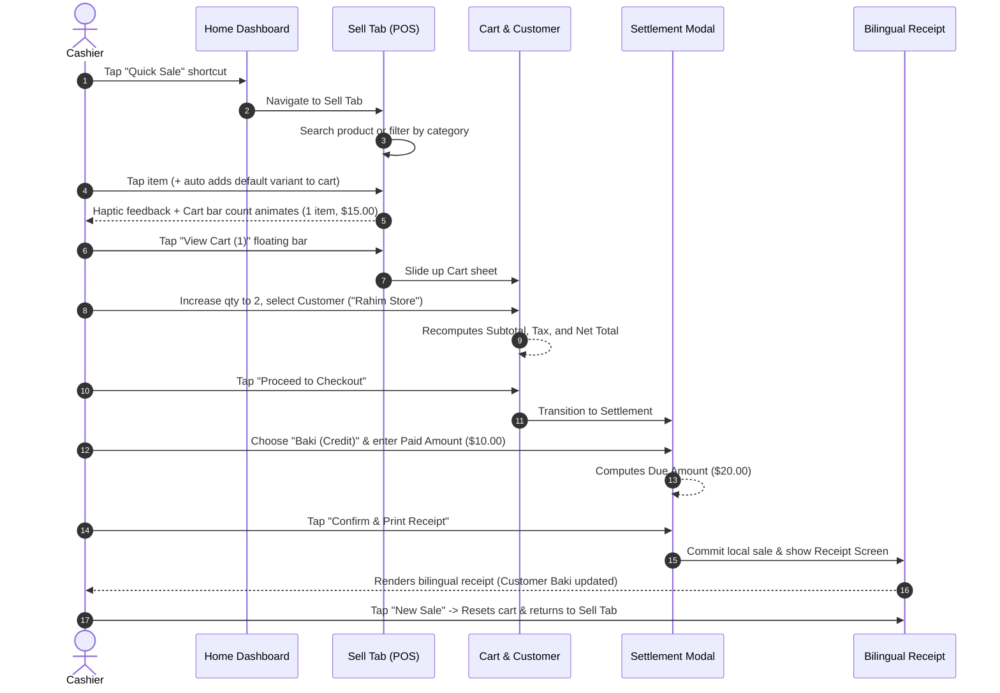
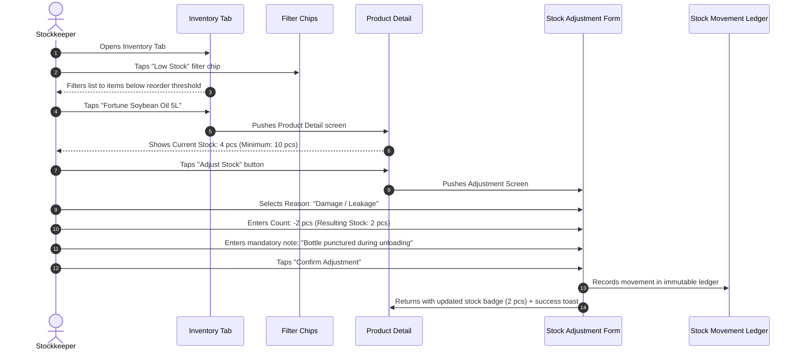

# Core Shop Mobile — UX Direction, Screen Inventory & User Journeys (M01-UI01)

Document Version: 1.0.0  
Date: 2026-10-16  
Phase: **M01-UI01** (Static UI/UX Foundation)  
Status: **Delivered & Documented**  
Companion Documents: [mobileProgress.md](mobileProgress.md), [mobileUiUxPlan.md](mobileUiUxPlan.md), [mobilePlan.md](mobilePlan.md)

---

## 1. Executive Summary & Objective

Phase **M01-UI01** establishes the design foundation, exhaustive screen inventory, high-density user journeys, accessibility requirements, and motion contracts for the Core Shop mobile application.

Following owner direction, Core Shop is built **Static-First**: every screen, tab, form, sheet, slider, filter, and edge state is designed and locally interactive with centralized fixtures under `src/staticData/` prior to dynamic server API integration.

---

## 2. Exhaustive Route & Screen Inventory (M01-UI01-01)

Below is the complete inventory of all routes defined for Core Shop mobile. Each route maps to its parent module/tab, role access, primary user goal, and phased launch scope. No route is dropped or deferred without explicit recording.

### 2.1 Entry, Authentication & Business Onboarding

| Route / File | Navigator / Layout | Role / Access | Primary User Goal | Launch Scope |
| :--- | :--- | :--- | :--- | :--- |
| `src/app/index.tsx` | Root Switcher | Public | Cold-start entry resolver; directs user to Auth or Private Tabs without flash or loops | **Launch (V1)** |
| `src/app/+not-found.tsx` | Root Stack | Public | Explains unreachable route; provides safe navigation back to Home or Login | **Launch (V1)** |
| `src/app/(auth)/_layout.tsx` | Auth Stack | Public | Enforces clean light styling, screen slide transitions, and dark status bar | **Launch (V1)** |
| `src/app/(auth)/login.tsx` | Auth Stack | Public | Authenticate with email/phone & password; view validation feedback; go to register | **Launch (V1)** |
| `src/app/(auth)/register.tsx` | Auth Stack | Public | Create new staff/merchant account; validation for name, email, password | **Launch (V1)** |
| `src/app/(auth)/forgot-password.tsx` | Auth Stack | Public | Request password recovery email with rate-limiting confirmation | **Launch (V1)** |
| `src/app/(auth)/reset-password.tsx` | Auth Stack | Public | Validate recovery token; enter and confirm new secure password | **Launch (V1)** |
| `src/app/(auth)/verify-email.tsx` | Auth Stack | Public | Enter email verification OTP/code; resend cooldown timer | **Launch (V1)** |
| `src/app/(onboarding)/_layout.tsx` | Onboarding Stack | Authenticated | Multi-step setup stack for organizations and branches | **Launch (V1)** |
| `src/app/(onboarding)/organizations.tsx` | Onboarding Stack | Authenticated | List authorized organizations; choose active tenant; accept pending invites | **Launch (V1)** |
| `src/app/(onboarding)/create-business.tsx` | Onboarding Stack | Authenticated | Setup new store identity: legal name, currency (BDT/USD), timezone, first branch | **Launch (V1)** |
| `src/app/(onboarding)/join-business.tsx` | Onboarding Stack | Authenticated | Enter staff invite code; review business details; join with designated role | **Launch (V1)** |
| `src/app/(onboarding)/select-branch.tsx` | Onboarding Stack | Authenticated | Select active store branch for operations; fallback if single branch | **Launch (V1)** |

### 2.2 Operational Bottom Tabs Shell `(private)/(tabs)/`

| Route / File | Tab Name | Required Permission | Primary User Goal | Launch Scope |
| :--- | :--- | :--- | :--- | :--- |
| `src/app/(private)/(tabs)/index.tsx` | **Home** | Authenticated | Real-time branch overview: daily sales, dues, quick sale shortcut, low stock alerts | **Launch (V1)** |
| `src/app/(private)/(tabs)/sell.tsx` | **Sell (POS)** | `SALE_CREATE` | Rapid product search, barcode lookups, variant selection, floating cart bar | **Launch (V1)** |
| `src/app/(private)/(tabs)/inventory.tsx` | **Inventory** | `INVENTORY_READ` | Scan and browse branch stock balances, low-stock warnings, filter by category | **Launch (V1)** |
| `src/app/(private)/(tabs)/activity.tsx` | **Activity** | Authenticated | Chronological feed of sales, purchases, customer payments, and expenses | **Launch (V1)** |
| `src/app/(private)/(tabs)/more.tsx` | **More** | Authenticated | Master directory: Contacts, Purchasing, Expenses, Reports, Settings, Profile | **Launch (V1)** |

### 2.3 Catalog & Product Management `(private)/products/`

| Route / File | Layout Type | Required Permission | Primary User Goal | Launch Scope |
| :--- | :--- | :--- | :--- | :--- |
| `products/[productId].tsx` | Screen Stack | `CATALOG_READ` | Inspect product details, multiple variants, pricing, branch stock, SKU/barcode | **Launch (V1)** |
| `products/new.tsx` | Screen Stack | `PRODUCT_CREATE` | Add new product: name, category, brand, unit, buy price, sale price, stock alert | **Launch (V1)** |
| `products/[productId]/edit.tsx` | Screen Stack | `PRODUCT_UPDATE` | Edit pricing, metadata, reorder thresholds; archive product with dependencies | **Launch (V1)** |

### 2.4 Sales, Cart, Checkout & Baki `(private)/sales/`

| Route / File | Layout Type | Required Permission | Primary User Goal | Launch Scope |
| :--- | :--- | :--- | :--- | :--- |
| `sales/index.tsx` | Screen Stack | `SALE_READ` | Search sales history by receipt #, date range, customer, payment status (Paid/Due) | **Launch (V1)** |
| `sales/cart.tsx` | Modal / Stack | `SALE_CREATE` | Review cart lines, adjust quantities, apply discounts/taxes, assign customer | **Launch (V1)** |
| `sales/checkout.tsx` | Modal / Stack | `SALE_CREATE` | Multi-method settlement (Cash, Card, bKash, Baki/Credit), enter paid amount, finalize | **Launch (V1)** |
| `sales/[saleId].tsx` | Screen Stack | `SALE_READ` | Committed invoice/receipt; bilingual English/Bangla formatting; print & share | **Launch (V1)** |
| `sales/[saleId]/return.tsx` | Screen Stack | `SALE_RETURN` | Process full/partial customer return, calculate refund, restock items | **Launch (V1)** |
| `sales/[saleId]/payment.tsx` | Modal / Stack | `PAYMENT_CREATE` | Collect outstanding Baki balance against invoice; record receipt | **Launch (V1)** |

### 2.5 Purchases & Supplier Operations `(private)/purchases/`

| Route / File | Layout Type | Required Permission | Primary User Goal | Launch Scope |
| :--- | :--- | :--- | :--- | :--- |
| `purchases/index.tsx` | Screen Stack | `PURCHASE_READ` | List purchase orders and received invoices with supplier and payment status | **Launch (V1)** |
| `purchases/new.tsx` | Screen Stack | `PURCHASE_CREATE` | Create stock purchase: select supplier, add items/variants, cost price, amount paid | **Launch (V1)** |
| `purchases/[purchaseId].tsx` | Screen Stack | `PURCHASE_READ` | Inspect Goods Received Note (GRN), received items, costs, supplier balance | **Launch (V1)** |
| `purchases/[purchaseId]/return.tsx` | Screen Stack | `PURCHASE_RETURN` | Return defective/damaged items back to supplier; decrease supplier payable | **Launch (V1)** |
| `purchases/[purchaseId]/payment.tsx` | Modal / Stack | `PAYMENT_CREATE` | Record disbursement payment to supplier for outstanding bills | **Launch (V1)** |

### 2.6 Inventory Workflows & Stock Adjustments `(private)/inventory/`

| Route / File | Layout Type | Required Permission | Primary User Goal | Launch Scope |
| :--- | :--- | :--- | :--- | :--- |
| `inventory/ledger.tsx` | Screen Stack | `INVENTORY_READ` | Audit trail of all stock movements (Sales, Purchases, Adjustments, Transfers) | **Launch (V1)** |
| `inventory/adjust.tsx` | Screen Stack | `INVENTORY_ADJUST` | Adjust branch stock with verified reason (Damaged, Expired, Inventory Count) | **Launch (V1)** |
| `inventory/transfers/index.tsx` | Screen Stack | `TRANSFER_READ` | View inter-branch inventory transfers and status (Pending, Shipped, Received) | *Later Phase (V2)* |
| `inventory/transfers/new.tsx` | Screen Stack | `TRANSFER_CREATE` | Initiate stock transfer from source branch to destination branch | *Later Phase (V2)* |
| `inventory/transfers/[transferId].tsx`| Screen Stack | `TRANSFER_MANAGE` | Receive transferred stock or cancel pending shipment | *Later Phase (V2)* |

### 2.7 Customers & Accounts Receivable (Baki Khata) `(private)/customers/`

| Route / File | Layout Type | Required Permission | Primary User Goal | Launch Scope |
| :--- | :--- | :--- | :--- | :--- |
| `customers/index.tsx` | Screen Stack | `CUSTOMER_READ` | Search customer list, view total receivables, call customer directly | **Launch (V1)** |
| `customers/new.tsx` | Screen Stack | `CUSTOMER_CREATE` | Register new customer: Name, Phone, Address, Credit Limit, Opening Balance | **Launch (V1)** |
| `customers/[customerId].tsx` | Screen Stack | `CUSTOMER_READ` | Customer profile, total dues badge, sales count, quick "Collect Payment" button | **Launch (V1)** |
| `customers/[customerId]/edit.tsx` | Screen Stack | `CUSTOMER_UPDATE` | Update contact details and credit limits; archive customer | **Launch (V1)** |
| `customers/[customerId]/ledger.tsx`| Screen Stack | `CUSTOMER_READ` | Complete ledger of sales (+), returns (-), and payments (-) with running balance | **Launch (V1)** |
| `customers/[customerId]/payment.tsx`| Modal / Stack | `PAYMENT_CREATE` | Record Baki payment collection, generate receipt, update ledger balance | **Launch (V1)** |
| `customers/[customerId]/statement.tsx`| Screen Stack | `CUSTOMER_READ` | Bilingual customer account statement ready for print/PDF share | **Launch (V1)** |
| `customers/[customerId]/sales.tsx` | Screen Stack | `CUSTOMER_READ` | History of all invoices billed to this specific customer | **Launch (V1)** |
| `customers/[customerId]/returns.tsx`| Screen Stack | `CUSTOMER_READ` | History of all return vouchers issued to this customer | **Launch (V1)** |

### 2.8 Suppliers & Accounts Payable (Dena) `(private)/suppliers/`

| Route / File | Layout Type | Required Permission | Primary User Goal | Launch Scope |
| :--- | :--- | :--- | :--- | :--- |
| `suppliers/index.tsx` | Screen Stack | `SUPPLIER_READ` | Search supplier list, view total outstanding payables | **Launch (V1)** |
| `suppliers/new.tsx` | Screen Stack | `SUPPLIER_CREATE` | Register supplier: Company, Contact Person, Phone, Address, Payment Terms | **Launch (V1)** |
| `suppliers/[supplierId].tsx` | Screen Stack | `SUPPLIER_READ` | Supplier profile, total payables badge, quick "Make Payment" action | **Launch (V1)** |
| `suppliers/[supplierId]/edit.tsx` | Screen Stack | `SUPPLIER_UPDATE` | Edit supplier details or archive | **Launch (V1)** |
| `suppliers/[supplierId]/ledger.tsx` | Screen Stack | `SUPPLIER_READ` | Supplier ledger of purchases (+), returns (-), and payments (-) | **Launch (V1)** |
| `suppliers/[supplierId]/payment.tsx`| Modal / Stack | `PAYMENT_CREATE` | Record disbursement to supplier against open purchase invoices | **Launch (V1)** |
| `suppliers/[supplierId]/statement.tsx`| Screen Stack | `SUPPLIER_READ` | Bilingual supplier account statement ready for export | **Launch (V1)** |

### 2.9 Expenses `(private)/expenses/`

| Route / File | Layout Type | Required Permission | Primary User Goal | Launch Scope |
| :--- | :--- | :--- | :--- | :--- |
| `expenses/index.tsx` | Screen Stack | `EXPENSE_READ` | Filter expenses by date, category (Rent, Utility, Salary, Tea/Snacks), view totals | **Launch (V1)** |
| `expenses/new.tsx` | Screen Stack | `EXPENSE_CREATE` | Log operational expense: category, amount, payment method, payee, notes | **Launch (V1)** |
| `expenses/[expenseId].tsx` | Screen Stack | `EXPENSE_READ` | View expense voucher details and creator audit trail | **Launch (V1)** |
| `expenses/[expenseId]/edit.tsx` | Screen Stack | `EXPENSE_UPDATE` | Correct expense details with immutable audit comment | **Launch (V1)** |

### 2.10 Reports & Financial Performance `(private)/reports/`

| Route / File | Layout Type | Required Permission | Primary User Goal | Launch Scope |
| :--- | :--- | :--- | :--- | :--- |
| `reports/index.tsx` | Screen Stack | `REPORT_READ` | Reports directory: Sales, P&L, Inventory Valuation, Expenses, Baki Aging | **Launch (V1)** |
| `reports/sales.tsx` | Screen Stack | `REPORT_SALES` | Sales volume, payment method split, discount totals by date range | **Launch (V1)** |
| `reports/profit.tsx` | Screen Stack | `REPORT_PROFIT` | Gross Sales, Cost of Goods Sold (COGS), Gross Profit, Expenses, Net Profit | **Launch (V1)** |
| `reports/inventory.tsx` | Screen Stack | `REPORT_INVENTORY` | Total stock value at cost and retail price; dead stock and low stock alerts | **Launch (V1)** |
| `reports/expenses.tsx` | Screen Stack | `REPORT_EXPENSES` | Expense breakdown chart and category distribution | **Launch (V1)** |
| `reports/balances.tsx` | Screen Stack | `REPORT_FINANCE` | Customer Baki vs Supplier Dena balance sheet; Aging (0-30, 31-60, 60+ days) | **Launch (V1)** |

### 2.11 Settings, Preferences & Administration `(private)/settings/`

| Route / File | Layout Type | Required Permission | Primary User Goal | Launch Scope |
| :--- | :--- | :--- | :--- | :--- |
| `settings/index.tsx` | Screen Stack | Authenticated | Central settings directory (Account, Store, Staff, Catalogs, Language, Cache) | **Launch (V1)** |
| `settings/security.tsx` | Screen Stack | Authenticated | Change password, enable biometrics lock, view login history | **Launch (V1)** |
| `settings/sessions.tsx` | Screen Stack | Authenticated | List all active mobile/web sessions with one-tap remote revoke | **Launch (V1)** |
| `settings/business.tsx` | Screen Stack | `ORG_ADMIN` | Store identity: Logo, store name, phone, address, tax number | **Launch (V1)** |
| `settings/branches/index.tsx` | Screen Stack | `ORG_ADMIN` | List store branches, view active staff per branch | **Launch (V1)** |
| `settings/branches/new.tsx` | Screen Stack | `ORG_ADMIN` | Add new store branch with unique address and code | **Launch (V1)** |
| `settings/branches/[branchId].tsx`| Screen Stack | `ORG_ADMIN` | Edit branch information or archive | **Launch (V1)** |
| `settings/team/index.tsx` | Screen Stack | `TEAM_READ` | Manage staff roster, role assignments (Manager, Cashier, Stockkeeper) | **Launch (V1)** |
| `settings/team/invite.tsx` | Screen Stack | `TEAM_MANAGE` | Send staff invite via phone/email with designated role preset | **Launch (V1)** |
| `settings/team/[membershipId].tsx`| Screen Stack | `TEAM_MANAGE` | Edit staff permissions, branch assignments, or revoke access | **Launch (V1)** |
| `settings/catalog.tsx` | Screen Stack | `CATALOG_MANAGE` | Master hub for Categories, Brands, and Units of Measure | **Launch (V1)** |
| `settings/catalog/categories.tsx`| Screen Stack | `CATALOG_MANAGE` | Add/edit product categories | **Launch (V1)** |
| `settings/catalog/brands.tsx` | Screen Stack | `CATALOG_MANAGE` | Add/edit product brands | **Launch (V1)** |
| `settings/catalog/units.tsx` | Screen Stack | `CATALOG_MANAGE` | Add/edit measurement units (pcs, kg, ltr, box, dozen) | **Launch (V1)** |
| `settings/sales.tsx` | Screen Stack | `ORG_ADMIN` | Configure receipt headers/footers, default tax %, allow negative stock | **Launch (V1)** |
| `settings/preferences.tsx` | Screen Stack | Authenticated | Switch app language (**English / বাংলা**), number formatting, haptic feedback | **Launch (V1)** |
| `settings/subscription.tsx` | Screen Stack | `ORG_ADMIN` | View current plan limits (product count, staff count) and renewal date | **Launch (V1)** |
| `settings/data.tsx` | Screen Stack | Authenticated | Check SQLite cache size, trigger manual sync, safe local cache purge | **Launch (V1)** |
| `settings/help.tsx` | Screen Stack | Authenticated | Help center, user guide, customer support contact | **Launch (V1)** |
| `settings/about.tsx` | Screen Stack | Authenticated | App version, terms of service, privacy policy | **Launch (V1)** |

### 2.12 User Profile, Notifications & Offline Sync

| Route / File | Layout Type | Required Permission | Primary User Goal | Launch Scope |
| :--- | :--- | :--- | :--- | :--- |
| `profile/index.tsx` | Screen Stack | Authenticated | User identity card, active roles, current branch, sign out | **Launch (V1)** |
| `profile/edit.tsx` | Screen Stack | Authenticated | Update user name, phone number, profile photo | **Launch (V1)** |
| `notifications/index.tsx` | Screen Stack | Authenticated | In-app alerts: Low stock reminders, staff invite responses, sync alerts | *Later Phase (V2)* |
| `notifications/[notificationId].tsx`| Screen Stack | Authenticated | Detailed view of notification message and related record jump link | *Later Phase (V2)* |
| `sync/index.tsx` | Screen Stack | Authenticated | Offline command queue status, pending transactions, retry actions | **Launch (V1)** |
| `sync/[commandId].tsx` | Screen Stack | Authenticated | Detailed sync conflict inspector with manual resolution options | **Launch (V1)** |

---

## 3. High-Priority User Journeys & State Recovery (M01-UI01-02)

### 3.1 Journey A: Cashier POS Fast Sale to Bilingual Receipt


#### Interruption, Concurrency & Recovery:
* **Interrupted Call / App Backgrounding**: Cart contents are persisted in Redux / local draft storage. Re-opening the app restores the active cart without loss.
* **Network Drop**: POS checkout completes locally in offline mode, marking the sale as `Pending Sync` with a subtle amber badge. No blocking spinners.
* **Customer Baki Limit Exceeded**: If the customer credit limit is exceeded, an inline amber alert warns the cashier with an authorized override button.

---

### 3.2 Journey B: Inventory Audit & Stock Adjustment


#### Interruption & Recovery:
* **Accidental Back Swipe**: If adjustment quantities were typed, an alert confirms: *"Discard stock adjustment? Your changes will be lost."*
* **Concurrent Stock Change**: If an online sale occurred in the background while counting, the review step highlights the delta: *"Current server stock is now 3. Recalculate variance?"*

---

## 4. UI/UX Skill Record, Design Brief & Accessibility (M01-UI01-03)

### 4.1 UI/UX Skill Integration Record
* **Project-Local Skills Activated**:
  * `ui-ux-pro-max` (`.agents/skills/ui-ux-pro-max/SKILL.md`): Visual hierarchy, Swiss minimalism, contrast rules, accessibility.
  * `expo-design-system` (`.agents/skills/expo-design-system/SKILL.md`): Component structure, tokens, variant prop patterns.
  * `expo-native-ui` (`.agents/skills/expo-native-ui/SKILL.md`): Native-feeling layout, safe-area insets, list performance.
  * `expo-animation` (`.agents/skills/expo-animation/SKILL.md`): Native driver animations, spring physics, reduced-motion fallbacks.
  * `react-native-skills` (`.agents/skills/react-native-skills/SKILL.md`): Memory-efficient FlatList/FlashList virtualization.

### 4.2 Design Brief: Minimalism & Swiss Style for Retail Operations
* **Aesthetic Direction**: High-utility, distraction-free Swiss minimalism. Clean surfaces, high data density, large readable numbers for monetary figures.
* **Palette Tokens**:
  * **Primary (Emerald Brand)**: `#059669` (Dark Emerald) / `#10B981` (Vibrant Emerald).
  * **Background & Cards**: `#FFFFFF` (Pure White surfaces), `#F8FAFC` (Slate-50 soft container backgrounds).
  * **Borders & Dividers**: `#E2E8F0` (Slate-200 subtle outlines).
  * **Typography**:
    * **Primary Text**: `#0F172A` (Slate-900) — Contrast Ratio: **16.1:1** on white.
    * **Secondary Text**: `#475569` (Slate-600) — Contrast Ratio: **5.8:1** on white.
    * **Muted / Inactive**: `#64748B` (Slate-500) — Contrast Ratio: **4.6:1** on white.
  * **Semantic Accents**:
    * **Destructive / Due Debt**: `#DC2626` (Red-600) / Surface: `#FEF2F2`.
    * **Success / Paid**: `#16A34A` (Green-600) / Surface: `#F0FDF4`.
    * **Warning / Low Stock**: `#D97706` (Amber-600) / Surface: `#FFFBEB`.
    * **Informative / Baki**: `#2563EB` (Blue-600) / Surface: `#EFF6FF`.

### 4.3 Terminology & Bilingual Dictionary
| English Term | Bengali Term (বাংলা) | Retail Meaning |
| :--- | :--- | :--- |
| **Sale** | **বিক্রি (Bikri)** | Retail customer transaction |
| **Purchase** | **ক্রয় (Kroy)** | Inventory acquisition from supplier |
| **Customer Credit (Due)**| **বাকি (Baki)** | Outstanding money receivable from customer |
| **Supplier Payable** | **দেনা (Dena)** | Money owed to wholesale supplier |
| **Customer Ledger** | **খাতা (Khata / Ledger)** | Full running statement of transactions & dues |
| **Receipt / Invoice** | **রশিদ / চালান (Roshid / Chalan)**| Document evidencing delivery and payment |
| **Cash** | **নগদ (Nogod)** | Physical currency payment |
| **Damage / Waste** | **ক্ষতিগ্রস্ত (Khotigrosto)** | Damaged or unsaleable goods write-off |

### 4.4 Mobile Accessibility Checklist (WCAG 2.1 AA)
- [x] **Color Contrast**: Normal text >= 4.5:1. Primary text (`#0F172A`) on white achieves 16.1:1. Secondary text (`#475569`) achieves 5.8:1.
- [x] **Touch Target Size**: Minimum 44×44 pt touch hit slop on all buttons, chips, and list cells.
- [x] **No Color-Only State**: Every status badge couples color with an explicit text label and icon (e.g. Red Circle + "Due / বাকি").
- [x] **Dynamic Type Support**: Font sizing utilizes rem/token scales that adapt to OS accessibility text size without truncation.
- [x] **Screen Reader Labels**: All interactive icons (`arrow-back`, search clear, cart badge) include `accessibilityLabel` and `accessibilityRole="button"`.
- [x] **Reduced Motion**: All spring and layout animations check `AccessibilityInfo.isReduceMotionEnabled()` to bypass transitions if preferred by the user.

---

## 5. Phone Wireframes & Component Pattern Inventory (M01-UI01-04)

### 5.1 Phone Wireframe: Home Dashboard & Sell POS Screen

```text
┌────────────────────────────────────────┐  ┌────────────────────────────────────────┐
│ [C] Core Shop          [Main Branch v] │  │ ‹ Sell (POS)          [Category: All v]│
├────────────────────────────────────────┤  ├────────────────────────────────────────┤
│ Today's Sales          Today's Profit  │  │ [Q Search product name or barcode... ] │
│ ৳ 42,500               ৳ 8,400         │  ├────────────────────────────────────────┤
│ +12% vs yesterday      Normal margins  │  │ [All] [Beverages] [Grocery] [Dairy]    │
├────────────────────────────────────────┤  ├────────────────────────────────────────┤
│ Total Baki (Due)       Low Stock Items │  │ ┌────────────────────────────────────┐ │
│ ৳ 18,200 (14 cust)     3 Products ⚠️   │  │ │ Fortune Oil 5L            ৳ 890.00 │ │
├────────────────────────────────────────┤  │ │ 5 in stock • SKU-4011      [+ Add] │ │
│ Quick Shortcuts                        │  │ └────────────────────────────────────┘ │
│ [ + New Sale ]   [ + Add Product ]     │  │ ┌────────────────────────────────────┐ │
│ [ Collect Baki ] [ Stock Adjustment ]  │  │ │ Pran Frooto 250ml          ৳ 25.00 │ │
├────────────────────────────────────────┤  │ │ 48 in stock • SKU-1092     [+ Add] │ │
│ Recent Activity                        │  │ └────────────────────────────────────┘ │
│ • Sale #1042 — ৳ 450 (Cash)   2m ago   │  │ ┌────────────────────────────────────┐ │
│ • Baki Paid — ৳ 1,200 (Rahim) 14m ago  │  │ │ ACI Pure Salt 1kg          ৳ 38.00 │ │
│ • Purchase #88 — ৳ 14,000     1h ago   │  │ │ Low Stock: 2 left ⚠️       [+ Add] │ │
├────────────────────────────────────────┤  ├────────────────────────────────────────┤
│ [Home] [Sell] [Inventory] [Act] [More] │  │ [ 🛒 2 Items • ৳ 915.00 | View Cart › ]│
└────────────────────────────────────────┘  └────────────────────────────────────────┘
```

### 5.2 Component Pattern Inventory (DRY Foundation for M01-UI02)

| Pattern Name | Location | Key Props / Variants | Accessibility & Behavior |
| :--- | :--- | :--- | :--- |
| `Screen` | `src/components/layout/Screen.tsx` | `keyboard`, `edges`, `safeArea` | Manages safe area insets & auto-keyboard dismissal |
| `AppHeader` | `src/components/layout/AppHeader.tsx`| `title`, `canGoBack`, `rightElement` | 56px height, 44px back button, clear typography |
| `Button` | `src/components/ui/Button.tsx` | `variant` (primary, secondary, danger, ghost), `size`, `loading` | Spring touch scale feedback, loading spinner |
| `TextField` | `src/components/ui/TextField.tsx` | `label`, `error`, `icon`, `secureTextEntry` | Visible focus border, password visibility toggle, error caption |
| `StatusBadge` | `src/components/ui/StatusBadge.tsx` | `status` (paid, due, partial, low_stock) | Pill styling, icon + text pair, semantic colors |
| `ListRow` | `src/components/ui/ListRow.tsx` | `title`, `subtitle`, `badge`, `amount`, `onPress` | High-density 64px row, chevron indicator |
| `FilterBar` | `src/components/ui/FilterBar.tsx` | `chips`, `activeId`, `onSelect` | Horizontal scroll with gentle bounce, active indicator |
| `CartFooterBar`| `src/components/sales/CartFooterBar.tsx`| `itemCount`, `totalAmount`, `onPress` | Floating elevated CTA with bounce badge count |
| `EmptyState` | `src/components/ui/EmptyState.tsx` | `icon`, `title`, `description`, `action` | Clean SVG icon, encouraging copy, primary action |

---

## 6. Phase Acceptance & Next Step Handoff

* **Acceptance Criteria**:
  1. Complete screen registry mapped to layout groups, permissions, and launch scope: **Satisfied (62 routes cataloged)**.
  2. End-to-end Cashier POS and Stockkeeper user journeys with interruption recovery: **Satisfied (Diagrammed & specified)**.
  3. UI/UX Skill references, Swiss styling, and WCAG AA accessibility recorded: **Satisfied**.
  4. Phone wireframes and DRY component inventory specified: **Satisfied**.

* **Next Phase**: **M01-UI02 — Design system, reusable patterns and static-data foundation** (`src/staticData/`).
