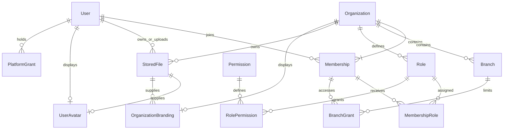
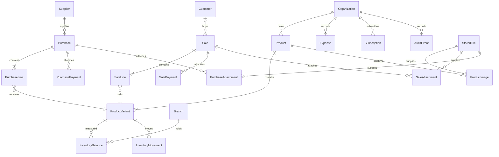

# Phase 2: tenant and database foundation

Status: Phase 2 foundation accepted when the owner authorized Phase 3. This design is supplemented by the Phase 3 API/security and R2 changes.

## Scope

This phase implements PostgreSQL/Prisma infrastructure and the identity, tenant, permission, branch, and private-file metadata schema. It provides migrations, reference seeds, database lifecycle cleanup, and `/ready`.

Commerce entities below are a reviewed design baseline for subsequent feature phases, not existing tables or endpoints. Authentication, registration APIs, role management APIs, object storage, and uploads are not enabled by this migration.

## Implemented relationships

### Identity and tenancy

- `User` is a global identity with normalized email and/or E.164 phone, optional password hash, verification timestamps, and lifecycle status. No plaintext credential or default account is seeded. The future authentication service must validate contact syntax and ownership, hash passwords with Argon2id, and control account transitions.
- `Organization` is the business tenant. Its initial currency and named timezone must be explicitly chosen. Currency scale is 0–4; quantity scale is 0–6. PostgreSQL validates timezone names. The future settings API must also validate actual supported ISO currency codes and freeze currency changes once financial records exist.
- `Membership` uniquely joins a user to an organization. Multiple owner memberships are allowed. Every non-archived organization must retain an active owner membership at transaction commit. Owner membership changes lock the organization row to serialize concurrent changes. Ownership transfer adds the replacement before removing the prior owner, in one transaction.
- Owner membership is a distinct business invariant, not a role name. The future permission resolver must explicitly recognize ownership and check current user/organization/membership status. Suspending a global user does not silently transfer ownership.
- Organization creation and its first owner membership must happen in a single transaction, including during registration onboarding. A draft organization may belong to a pending-verification user, but activation and sensitive operations require verification in the future registration service.
- Branch codes and role codes are unique inside an organization. Composite foreign keys prevent membership-role and branch-grant relationships crossing tenant boundaries.
- Branch access defaults to `SELECTED`, with no grants. Owners must have `ALL` branch access. `ALL` never means access to another organization. Archived branches are excluded by future authorization services.
- `Permission` is a global reference catalog. `Role` is organization-owned; presets will be instantiated in Phase 5. Role grants are scoped through membership and organization, not client-provided role names.
- `PlatformGrant` is separate from customer membership. Runtime database credentials cannot modify it. Platform support/admin status confers no automatic access to customer transactions. Any later exceptional support access requires its own audited, expiring grant.

### Identifiers, deletion, and time

Public identifiers are UUIDs generated by Prisma. Timestamps use `timestamptz(3)` and API dates use UTC ISO 8601. Database relationships use `RESTRICT`, preventing cascade deletion of business ownership or evidence.

User deletion and organization archival are explicit states with matching timestamps. Archiving is not a data-retention policy. Financial retention, anonymization, and object deletion require separate reviewed workflows. Do not reuse deleted identities without an account-recovery policy.

## Phase 3 additions

The additive migration adds `User.preferredLanguage`, append-only audit events, durable command records, and transactional outbox events. Audit actor membership and branch references remain tenant-scoped. R2 file metadata now uses separate source/final ETags and an immutable verified object key; no S3 version ID is required. See [API/security](api-security.md), [R2 uploads](uploads.md), and the updated [Baki ledger design](credit-ledger-design.md).

## Future commerce relationships

Every tenant-owned table carries `organizationId`. Tenant-owned references use composite `(organizationId, id)` keys, including branch references. Globally unique IDs alone do not prevent cross-tenant references.

| Entity group | Relationships and invariants to implement |
| --- | --- |
| Catalog | Organization → category/brand/unit/product → variant; SKU/barcode uniqueness is tenant-scoped; one default variant; archive instead of deleting referenced products |
| Parties | Organization → customers/suppliers; contacts are bounded and access-controlled; balances derive from transactions rather than arbitrary edits |
| Inventory | Organization + branch + variant → balance; immutable movements reference the originating document/line; balances update atomically with movements |
| Purchases | Organization + branch + supplier → purchase → purchase lines → variants; posting creates stock receipts and payables in one transaction |
| Sales | Organization + branch + optional customer → sale → sale lines → variants; posting stores historical cost and updates stock/receivables atomically |
| Returns | Return header/lines explicitly reference original sale/purchase lines; returned quantity and refunded amount cannot exceed eligible originals |
| Payments | Explicit sale-payment and purchase-payment allocation tables with tenant-scoped foreign keys; no unconstrained `targetType/targetId` pair |
| Expenses | Organization + optional branch + expense category; exact amount, currency, actor, and event timestamp |
| Plans | Global plan/version definitions; organization subscription history and trusted entitlement overrides; provider event IDs are unique for retry safety |
| Audit | Append-only actor, organization, action, entity ID, timestamp, request ID, and redacted changes; no credentials or file bytes |
| Retry safety | Organization + actor + operation + idempotency key unique, with request hash, state, result reference, and bounded retention |
| Images and attachments | Explicit ProductImage, SaleAttachment, PurchaseAttachment, and OrganizationDocument bindings; every binding has a scoped FK to its parent and StoredFile |

### Numerical and transaction rules

Proposed storage baseline for future migrations: money `numeric(20,4)`, quantity `numeric(20,6)`, unit costs `numeric(24,8)`, and rates `numeric(9,6)`. These are storage capacities, not permission to exceed an organization's configured precision. Financial API values are decimal strings and never JavaScript floating-point calculations.

Calculate with decimal arithmetic, round posted currency amounts once using a documented half-up policy at the organization's currency scale, and persist line/document totals. Tax and discount ordering and invoice rounding must be reviewed before sales/purchase implementation. Store invoice currency and cost snapshots so future settings or purchases cannot rewrite historical results.

Weighted-average costing is the initial design. Negative stock defaults to disabled. Posting locks the relevant balance rows in deterministic order and commits document state, movements, balances, payment allocations, and audit/idempotency records together. Draft documents do not change stock. Posted records are corrected by linked reversals, not destructive edits. Concurrent returns/refunds must lock original eligible quantities/allocations.

Expected lifecycles: document `DRAFT → POSTED → REVERSED`; subscription `TRIALING/ACTIVE/PAST_DUE/CANCELED/EXPIRED`, finalized with billing rules later. Exact document cancellation and return states remain part of each feature's acceptance review.

## Database privileges and RLS decision

Use separate logins:

- `MIGRATION_DATABASE_URL`: schema owner for reviewed migrations and reference seed. Never used by request handlers.
- `DATABASE_URL`: restricted `core_shop_runtime` login. No superuser, role creation, database creation, bypass-RLS, table ownership, or schema creation. Reference permissions, platform elevation, and migration history are read-only.

`scripts/database/grant-runtime.sql` grants only the current schema's application privileges. Apply it after migrations. New tables require explicit review; no default future write grants are installed. Readiness rejects privileged application connections as well as missing/unfinished/unexpected migrations.

**RLS is evaluated and deferred until authenticated tenant context exists.** Phase 2 has no authenticated business endpoints. Enabling policies driven by an untrusted request organization ID would provide misleading protection. Composite foreign keys already enforce write relationships, but do not hide rows from unscoped reads. Before exposing business routes, repository queries must scope every read and write to a membership verified from the authenticated identity. UUID secrecy is not authorization.

When RLS is introduced, use transaction-local context on the same database connection, include `WITH CHECK`, force policies where appropriate, keep runtime non-owner/non-bypass, and test absent context, cross-tenant access, rollback, pool reuse, background jobs, and support access. Do not claim database-enforced read isolation until those policies exist.

## Readiness and operational behavior

`GET /health` remains process liveness. `GET /ready` returns 200 only when the restricted database login connects, the exact expected migration history is complete, and representative current-model queries succeed. Otherwise it returns a generic 503 without credentials, SQL, hostnames, or database diagnostics.

Connections are lazy so database downtime does not break liveness. Pools and queries have configured bounds and close on application shutdown. Readiness is a compatibility check, not a full schema-drift audit or a guarantee that every future dependency is healthy. Redis does not contribute yet because the application does not use it.

## Verification and review

Integration tests require a disposable local `core_shop_test_*` database and refuse other names/hosts. They verify tenant reference boundaries, last-owner protection, avatar/branding ownership, verified file lifecycle, restricted runtime privileges, and readiness. Regular tests never load environment files.

Owner review should cover tenant/owner semantics, numerical precision, currency/timezone rules, personal versus business file ownership, upload limits, RLS staging, and the future commerce model before feature migrations expand the schema.

## References

- [Prisma generator configuration](https://www.prisma.io/docs/orm/v7/prisma-schema/overview/generators)
- [Prisma CLI configuration](https://docs.prisma.io/docs/orm/reference/prisma-config-reference)
- [PostgreSQL row security and bypass behavior](https://www.postgresql.org/docs/current/ddl-rowsecurity.html)
