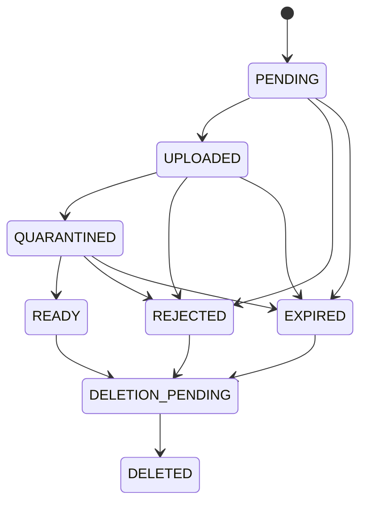

# Private files and onboarding

## Selected provider: Cloudflare R2

Cloudflare R2 is the chosen private object store. Phase 3 adapts file metadata to R2's capabilities; provider API calls and upload/download endpoints remain in the files phase. Keep public bucket access and `r2.dev` disabled for customer files.

R2 does not implement S3 bucket versioning. Each reservation therefore has a mutable quarantine `objectKey` and a separate server-only `finalObjectKey`. The latter includes the owner, file ID, and verified SHA-256. Store source/final ETags as storage identity hints; ETags are not content checksums. Legacy optional `sourceVersion`/`storageVersion` fields are not required or used for R2.

The finalizer will download bounded source bytes, verify/scan/normalize them, and write those exact processed bytes to a fresh verified key using a conditional create (`If-None-Match: *`). Only trusted server credentials may write verified keys. If a retry finds the key present, verify the existing content before adopting it; never overwrite it. Store the resulting key, ETag and checksum together before setting READY. A reused upload URL can affect only the quarantine key, never the object used for downloads.

Use region `auto` and the account-derived private S3 endpoint. Account/access credentials remain server-side and scoped to the selected bucket. R2 CORS must separately allow only the application origins and required signed request headers when direct browser uploads are introduced. User profile/tenant authorization is still checked by our API before issuing a signed capability.

References: [R2 S3 API compatibility](https://developers.cloudflare.com/r2/api/s3/api/) and [conditional operations](https://developers.cloudflare.com/r2/api/s3/extensions/).

## Scope and ownership

Phase 2 implements file metadata, admission policies, ownership constraints, lifecycle guards, and avatar/branding bindings. It does not expose upload/download endpoints or connect an object-storage provider. No files are publicly served by the API.

| Purpose | Owner | Allowed types | Maximum size |
| --- | --- | --- | --- |
| User / owner profile photo | User | JPEG, PNG, WebP | 5 MiB |
| Business/shop logo | Organization | JPEG, PNG, WebP | 5 MiB |
| Shop cover | Organization | JPEG, PNG, WebP | 10 MiB |
| Product image | Organization | JPEG, PNG, WebP | 10 MiB |
| Sale invoice/receipt attachment | Organization | JPEG, PNG, WebP, PDF | 20 MiB |
| Purchase invoice/receipt attachment | Organization | JPEG, PNG, WebP, PDF | 20 MiB |
| Business document | Organization | JPEG, PNG, WebP, PDF | 20 MiB |

The owner's profile photo is the user's avatar, not a second copy tied to a shop. One identity can belong to multiple businesses. Shop logos/covers remain business-owned when staff leave or ownership transfers. A different organization-specific staff portrait, if later required, must use an explicit new purpose and binding.

Product and transaction purposes are reserved now. Their actual binding tables will be introduced with the corresponding domain tables; generic unvalidated `entityType/entityId` attachments are not used. Limits are initial engineering defaults for owner review, not subscription allowances. Organization storage quotas and rate limits must also be enforced when upload APIs are implemented.

## Registration-time and later uploads

1. Submit textual registration details over HTTPS. The future auth service creates a pending-verification user and issues a tightly scoped onboarding session after its abuse controls succeed. Anonymous users cannot reserve arbitrary files.
2. Create a draft organization and its initial owner membership atomically. Avatar/logo/cover are optional and never block account creation.
3. Authorize the current identity for the requested owner and purpose. Personal avatars must belong to that same user. Shop branding requires current owner or organization-settings permission. Verify membership and branch/domain permissions again for later product and invoice attachments.
4. Reserve a `PENDING` file with an opaque, server-generated object key and a bounded upload expiry. Do not accept client bucket names, arbitrary storage keys, remote image URLs, or claimed organization ownership.
5. Issue a short-lived, single-object upload capability with size/type restrictions. Keep storage private and upload into a quarantine location. This storage integration is future work.
6. Confirm source storage metadata on the server, then independently verify the downloaded bytes and record the source ETag. Never trust the client to mark completion or supply verified MIME type, checksum, or scan results.
7. Decode the actual image/PDF format, enforce size and image pixel bounds, scan for malware, and normalize images. Strip EXIF/GPS metadata. Reject decompression bombs, SVG/HTML, polyglots, and unsupported content. If processing fails, remain quarantined or reject; do not fail open.
8. Attach only a `READY` file of the exact purpose and owner. Use a transaction and row locks for attachment changes. Registration and later profile updates use the same attachment rules.

The future registration flow must persist the immutable verified object key before setting READY, and serve only that key. R2 final keys are server-controlled; storage credentials capable of overwriting them are privileged and must never reach clients. Database constraints cannot prevent a compromised storage administrator from mutating a bucket.

## Database lifecycle

SQL constraints require exactly one owner scope and enforce purpose, type, size, checksum format, and bounded image dimensions. READY requires CLEAN scan status, independently verified MIME type, source byte count matching the reservation, processed byte count within the purpose limit, SHA-256 of the processed bytes, verification time, source/final ETags, and an owner-scoped verified object key. Initial file insertion cannot bypass PENDING. Reservation identity and storage key are immutable.

Triggers reject avatars/logos/covers referencing the wrong owner, purpose, or lifecycle state. A bound file cannot change verified content or leave READY until detached. Replacement attaches the new ready image atomically; the old object is queued for eligible cleanup after commit. No object deletion is performed inside a database transaction.

These constraints validate metadata and relationships; they cannot inspect object bytes or prove that a scanner actually ran. Only trusted server/worker code may write verification results. Before implementing uploads, split scanner/finalization privileges from upload reservation privileges and add end-to-end tests using actual storage objects and malicious samples.

## Access, retention, and cleanup

- Authorize every download against current identity, tenant, domain record, and permission. Do not return permanent public URLs or accept possession of an object key as authorization.
- Issue short-lived signed reads for the verified final key only after authorization. For immediate revocation requirements, stream through an authorization proxy; an issued signed URL remains usable until it expires.
- Store original filenames as untrusted display metadata. Never use them as filesystem paths or object keys. Serve documents as attachments with safe content headers; images use normalized verified formats.
- Expire abandoned onboarding reservations and reconcile orphaned storage objects. A future cleanup worker performs idempotent deletes and marks DELETED only after storage confirms deletion.
- Keep invoices and retained documents when users leave. Apply reviewed legal/business retention holds before deletion. Removing a profile association does not immediately destroy evidence.
- Audit reservations, finalization, binding replacement, download authorization where required, rejection, and deletion without logging file bytes, credentials, signed URLs, or sensitive document contents.

Cloudflare R2 is selected and a durable transactional outbox exists. Bucket provisioning, malware scanner, delivery/cleanup workers, signed capability implementation, account verification provider, and retention periods remain later work. File APIs must not be enabled until those controls exist.

Reference: [OWASP File Upload Cheat Sheet](https://cheatsheetseries.owasp.org/cheatsheets/File_Upload_Cheat_Sheet.html).
